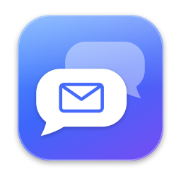
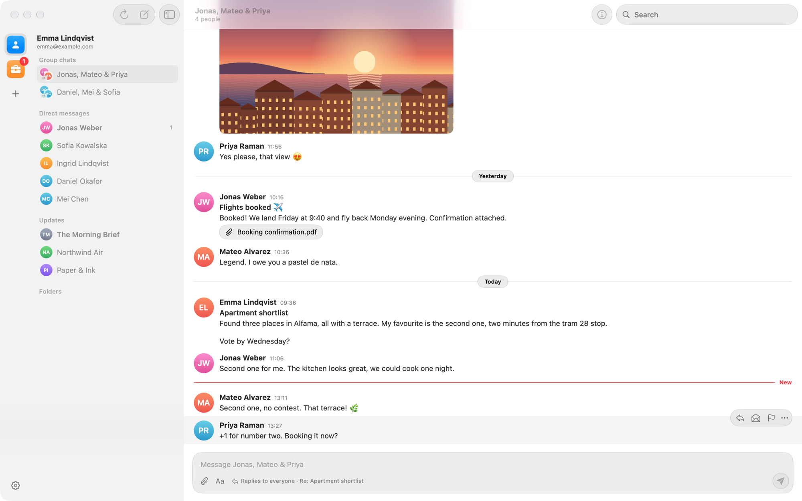
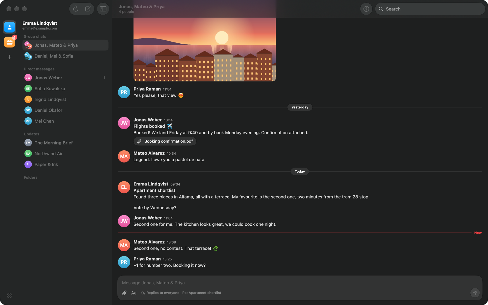
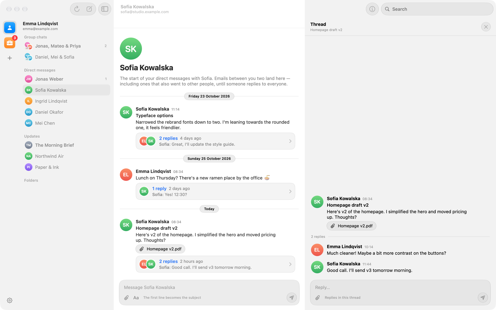
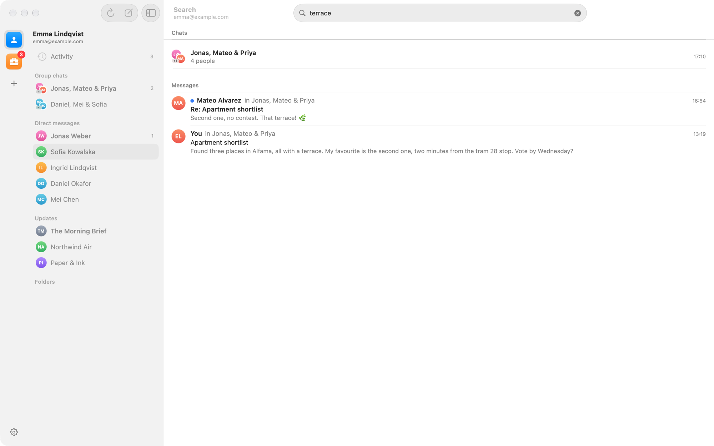
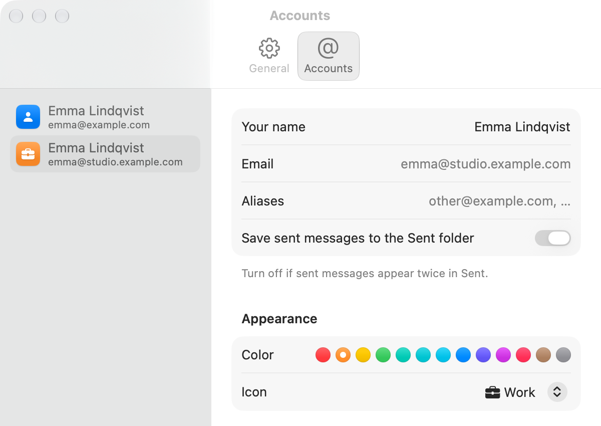

<p align="center">
  
</p>

<h1 align="center">qMail</h1>

<p align="center">
  Email that reads like a chat.<br>
  A native macOS mail client that turns your inbox into Slack-style conversations, built with SwiftUI and Liquid Glass.
</p>

<p align="center">
  
  
</p>

## Features

qMail is organized like Slack. Each account is a workspace, and every email lives in a chat with the people on it. An email and its replies form a thread. Once someone replies to everyone on an email, the conversation becomes a group chat for exactly those people.

- **Chats instead of an inbox.** The sidebar lists *Starred*, *Group chats*, *Direct messages* and *Updates* (newsletters and notifications). Mail you send only to yourself goes to your own "(you)" chat.
- **Threads.** In a direct message, each email conversation is one message, and its replies collapse into a card like "2 replies · Sofia: Good call…". Click it to open the thread beside the chat.
- **Clean messages.** Quoted text, "On … wrote:" headers (in English, Czech, German, French, Spanish and more), signatures and mobile footers are stripped. Photos show inline; signature logos and tracking pixels don't.
- **Reply in place.** There are no compose windows. Type at the bottom of a chat to start a new email to everyone in it (the first line becomes the subject), or in a thread to reply. Other people just see normal email, with proper `Re:`, `In-Reply-To` and `References` headers.
- **Activity.** Every email in a workspace in one list, newest first and grouped by day. Filter it to people or unread mail, and click an email to open it in its chat.
- **Search everything.** Results open right under the search field in the middle of the toolbar: matching chats first, then every matching email. qMail downloads the text of every email in the background into a local full-text index, so search covers your whole mailbox, not just recent mail, and ignores case and accents.
- **Workspaces.** Switch accounts in the rail on the left or with <kbd>⌘1</kbd>–<kbd>⌘9</kbd>. Give each account its own color and icon, and hover over an icon to see which address it is.
- **Push.** New mail arrives within seconds over IMAP IDLE.
- **Folders when you need them.** Inbox, Sent, Archive and your own folders are still there, with a classic message list and reader.
- **Private by default.** HTML mail is rendered with JavaScript off and remote images blocked until you load them. Passwords and tokens are kept in the Keychain, and the app is sandboxed.
- **Updates itself.** Once a day qMail checks GitHub for a new release and shows what's new. *Install and Relaunch* downloads it, checks it's signed by the same developer, swaps it in and opens it again. Turn it off or check now in Settings › General, or use qMail › Check for Updates….
- **No dependencies.** IMAP, SMTP, MIME, OAuth 2 and threading are implemented from scratch in the local `MailCore` Swift package.

<p align="center">
  
</p>

<p align="center">
  
  
</p>

## Requirements

- macOS 26 Tahoe or later
- Xcode 26 or later to build

## Install

Download **qMail-x.y.dmg** from the [latest release](https://github.com/HonzaKubita/qMail/releases/latest), open it and drag **qMail** to Applications. The app is signed with Developer ID and notarized by Apple. From version 1.1 on, qMail installs new versions itself.

Or build it from source:

```bash
open qMail.xcodeproj
```

and press <kbd>⌘R</kbd>. The project uses automatic signing with team `5GYRSQQ6CW`; change it under *Signing & Capabilities* if needed.

## Adding accounts

| Provider | How to sign in |
| --- | --- |
| Gmail | **Sign in with Google** in a secure browser window. An [app password](https://myaccount.google.com/apppasswords) also works, via "Use an App Password Instead". |
| iCloud | An app-specific password from [account.apple.com](https://account.apple.com) › Sign-In and Security. |
| Yahoo, AOL, Fastmail | An app password from your account's security settings. |
| Any other provider | Your email and password. Server settings are looked up in Mozilla's ISP database, or you can enter them yourself. |
| Outlook, Hotmail, Microsoft 365 | Not available yet. Outlook's IMAP server only accepts **Sign in with Microsoft**, and qMail doesn't have a Microsoft OAuth client registered yet (see [OAuth clients](#oauth-clients)). |

## How it works

| | |
|---|---|
| Building chats | Messages from Inbox, Sent and Archive (or Gmail's All Mail) are deduplicated by Message-ID and grouped into threads with union-find over `Message-ID`, `In-Reply-To`, `References` and Gmail's `X-GM-THRID`. |
| Who's in a chat | Everyone in From, To and Cc except you. Your aliases are learned from what you send. |
| Group chats | A thread joins the group chat for everyone involved once a reply goes to two or more people. Until then, each email stays in the direct message with its sender, or with each recipient if you sent it. |
| Updates | Threads made only of automated mail (`List-Id`, `List-Unsubscribe`, `Precedence: bulk`, no-reply senders) go to *Updates*, unless you've written in them. |
| Search | A SQLite FTS5 index per account, with diacritics removed. It stores each message's own text, up to its first 100 KB, from Gmail's All Mail or every folder except Junk, Trash and Drafts. Progress and disk use are in Settings › General, where you can also turn it off. |
| Sync | Each folder keeps its newest 250 messages locally (configurable); *Load Older Messages* and *Search on Server* reach the rest. IMAP IDLE pushes new mail, with a periodic refresh as a fallback. |
| Networking | `URLSessionStreamTask` with TLS and STARTTLS. IMAP with IDLE, MOVE, UIDPLUS and Gmail extensions; SMTP with PLAIN, LOGIN and XOAUTH2. |
| Sign-in | OAuth 2 with PKCE in an `ASWebAuthenticationSession`. Tokens and passwords are stored in the Keychain. |

## Development

```bash
cd MailCore && swift test      # unit tests
swift run MailProbe            # checks TLS/STARTTLS and capabilities of every built-in provider (no login)
```

```
qMail/                  SwiftUI app
  App/                  App entry point, commands, debug hooks (Debug builds only)
  Store/                MailStore (sync, actions, chats), search index, Keychain, cache, settings
  Views/                Sidebar, chats, threads, message list, reader, compose, settings
MailCore/               Swift package with no app or UI code
  Transport/            TLS and STARTTLS connection
  IMAP/                 Response parser and client
  SMTP/                 Submission client
  MIME/                 Header and body parsing, encodings, HTML to text, message builder
  Auth/                 OAuth 2 + PKCE, ISP autodiscovery
  Chats/                ChatBuilder, QuoteStripper
qMailUpdater/           Helper app that swaps in a downloaded update (qMail itself is sandboxed)
Tools/fake_mail_server.py   Local IMAP/SMTP server with sample conversations
```

The Xcode project uses folder-synchronized groups, so new files under `qMail/` are picked up without editing the project.

### Testing against a fake server

To exercise the whole app without touching your real accounts, build a separate dev copy. It has its own bundle ID, so it gets its own sandbox container and Keychain items. Then run the fake server and point the dev copy at it:

```bash
xcodebuild -project qMail.xcodeproj -scheme qMail -configuration Debug -derivedDataPath build/DevDerivedData \
  QMAIL_ID_SUFFIX=.dev2 QMAIL_NAME_SUFFIX=Dev \
  CODE_SIGN_STYLE=Manual "CODE_SIGN_IDENTITY=Apple Development" DEVELOPMENT_TEAM=5GYRSQQ6CW build
python3 Tools/fake_mail_server.py
QMAIL_TEST_SERVER=2 QMAIL_SELECT=chat:0 build/DevDerivedData/Build/Products/Debug/qMailDev.app/Contents/MacOS/qMailDev
QMAIL_FAKE_SERVER=1 swift test --package-path MailCore     # IMAP/SMTP integration tests
QMAIL_TEST_SERVER=remove build/DevDerivedData/Build/Products/Debug/qMailDev.app/Contents/MacOS/qMailDev   # remove the test accounts
```

Sign the dev copy with your development certificate, as above. An ad-hoc signature changes with every build, which makes macOS ask for Keychain and app-data access each time.

The screenshots in this README come from `python3 Tools/fake_mail_server.py --demo`, which serves fictional conversations instead, with `QMAIL_TEST_SERVER=demo QMAIL_WINDOW=1440x900 QMAIL_APPEARANCE=light QMAIL_SELECT=chat:0`. Other Debug-only hooks are documented in [`qMail/App/DebugSupport.swift`](qMail/App/DebugSupport.swift).

### Releasing

Bump `MARKETING_VERSION` (and `CURRENT_PROJECT_VERSION`) first. Release builds are signed for Ceska IT Akademie, z.s. (`HKN7A63ZT3`) with Developer ID. Xcode manages the certificate and provisioning with the Apple ID signed into it, so no passwords are needed:

```bash
xcodebuild -project qMail.xcodeproj -scheme qMail -configuration Release -destination 'generic/platform=macOS' \
  -archivePath build/release/qMail.xcarchive -allowProvisioningUpdates DEVELOPMENT_TEAM=HKN7A63ZT3 archive
# ExportOptions.plist: method developer-id, destination upload, signingStyle automatic, teamID HKN7A63ZT3
xcodebuild -exportArchive -archivePath build/release/qMail.xcarchive -exportOptionsPlist ExportOptions.plist \
  -exportPath build/release/export -allowProvisioningUpdates     # uploads to Apple's notary service
xcodebuild -exportNotarizedApp -archivePath build/release/qMail.xcarchive -exportPath build/release/notarized
```

The last command fails with "not ready for distribution" until Apple finishes notarizing, which usually takes a few minutes; run it again until it succeeds. It writes the notarized app with its ticket stapled. Then package it, as a disk image for new installs and a zip for the in-app updater:

```bash
mkdir build/release/dmg && ditto build/release/notarized/qMail.app build/release/dmg/qMail.app
ln -s /Applications build/release/dmg/Applications
hdiutil create -volname qMail -srcfolder build/release/dmg -format UDZO build/release/qMail-<version>.dmg
ditto -c -k --keepParent build/release/notarized/qMail.app build/release/qMail-<version>.zip
```

Publish a GitHub release tagged `v<version>` with both files; its notes are what the update window shows. qMail looks at `releases/latest`, downloads the `qMail-<version>.zip` asset and installs it only if the app inside is `com.honzakubita.qmail` at that version, signed by the same team as the running copy.

### How updating works

qMail is sandboxed, so it can't replace its own app. It downloads and checks the update itself, then opens **qMail Updater** (`qMail.app/Contents/Helpers/`, not sandboxed) with a small request file (sandboxed apps can't pass launch arguments) and quits. The helper waits for qMail to exit, checks the new copy's signature again, swaps it in (keeping the old copy until the new one is in place), clears the quarantine flag and opens it. To try it, build a newer copy (`MARKETING_VERSION=9.9`), zip it, serve a release JSON on localhost and run a Debug build with `QMAIL_UPDATE_FEED=http://localhost:…/latest.json` (add `QMAIL_UPDATE_INSTALL=1` to install without clicking).

## OAuth clients

"Sign in with Google" and "Sign in with Microsoft" use OAuth clients that are registered for qMail and built into the app in [`qMail/Store/OAuthClients.swift`](qMail/Store/OAuthClients.swift). Native apps are public clients, so these IDs are not secrets. If an ID is empty, that sign-in button is disabled.

If a Google sign-in expires (Google limits refresh tokens to 7 days while the app is in *Testing*) or is revoked, the account shows **Sign In Again…** in the sidebar.

### Google

1. In the [Google Cloud Console](https://console.cloud.google.com/), create a project (for example "qMail").
2. **Google Auth Platform ▸ Branding**: set the app name, support email and developer contact, and the links to the website in [`docs/`](docs/) (served by GitHub Pages from `main`, folder `/docs`): home page `https://honzakubita.github.io/qMail/`, privacy policy `…/privacy.html` and terms of service `…/terms.html`. The app name must match the name on the website, and the site's domain must be listed under *Authorized domains* and verified in Google Search Console.
3. **Audience**: choose *External*. While the app is in *Testing*, add every Google account that will sign in as a test user. *In production* (unverified) there is a user cap and a warning screen, but no 7-day sign-in expiry.
4. **Data access ▸ Add or remove scopes**: add `https://mail.google.com/`, `openid`, `email` and `profile`.
5. **Clients ▸ Create client**: application type **iOS**, bundle ID `com.honzakubita.qmail`. If the client shows *Advanced settings ▸ Enable custom URI scheme*, turn it on.
6. Put the client ID (`….apps.googleusercontent.com`) into `OAuthClients.googleClientID`. The redirect URI `com.googleusercontent.apps.<id>:/oauth2redirect` is derived from it, and no client secret is needed.

### Microsoft

1. In [Microsoft Entra ▸ App registrations](https://entra.microsoft.com/#view/Microsoft_AAD_RegisteredApps/ApplicationsListBlade), register an app for **Accounts in any organizational directory and personal Microsoft accounts**.
2. **Authentication ▸ Add a platform ▸ Mobile and desktop applications**: add `msauth.com.honzakubita.qmail://auth`.
3. **API permissions**: add the delegated permissions `IMAP.AccessAsUser.All` and `SMTP.Send` (Office 365 Exchange Online), plus `offline_access`, `openid`, `email` and `profile`.
4. Put the Application (client) ID into `OAuthClients.microsoftClientID`.

## Limitations

- Outlook and other Microsoft accounts can't be added until a Microsoft OAuth client is registered.
- Composing is plain text, with attachments. Drafts are not synced to the server.
- Sending needs a connection; there is no offline outbox yet.
